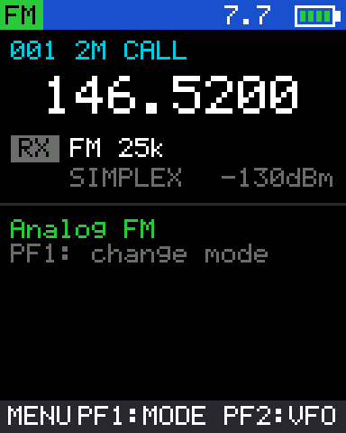

# D168UV custom firmware (cfw168)

The D890UV custom firmware ported to the AnyTone **D168UV** (Artery AT32F403A, Cortex-M4F, 1 MB flash, 224 KB SRAM).
All digital modes (DMR incl. Tier III, P25 Phase 1/2 incl. trunking, D-STAR, NXDN, YSF), analog FM,
simplex / talkaround / CC-NAC-RAN-DG-ID filters, MCU-DSP demodulators + PWM (PB9) TX audio path, vocoder backends
(sine / IMBE / SCT3288 with the chip's mic and speaker, `../../D890UV/D890UV_src/cfw/docs/SCT3288_VOCODER.md`), the "D8CP" codeplug and the PROGRAM/R/W CPS link.

**Nothing here has been run on a real radio. Never flash `make EMU=1` builds; use `make HW=1` and the guarded
`D890UV_src/tools/hw` flow (owner's OK) — and never touch 0x08000000–0x08003FFF (bootloader).**



## Structure: shared code, own board layer

```
D168UV/cfw/
  shared -> ../../D890UV/D890UV_src/cfw     symlink: everything above the board layer is the D890UV cfw, compiled as is
  include/at32f403a.h                       AT32F403A register map (F1-style peripherals)
  include/board_cfg.h                       board overrides picked up by the shared code (see below)
  hal/board.h                               D168UV pin map (with stock V1.07 function references)
  startup/startup.c, ld/at32f403a_cfw.ld    vectors at 0x08004000, 224 KB RAM, flash map asserts
  drivers/                                  clock time gpio lcd keys encoder power adc dac nand rf baseband settings flash uart
  app/main.c                                boot + main loop (D890 main.c with one RF chip, D168 NAND marker)
  docs/CODEPLUG.md                          D168 codeplug layout (format = D890 "D8CP" v1)
  tools/annotate_decomp.py                  annotate the stock decompile with peripheral names (GPIOA, DMA1+0x8 ...)
  tools/cscheck.sh                          compile-check emulator C# models without Renode
```

From `shared/` (unchanged code, not forked): `proto/*` (DMR/NXDN, P25, D-STAR/YSF libraries), `dsp/`, `voc/` (sine,
IMBE), `hal/` (modem, dsp_backend, voice, voc_sct, emu_syms), `gfx/`, `app/` (radio, channels, ui, cfwcp, prog,
protos/). The shared sources got small `#ifndef` hooks so a board can override a few constants — the D890UV build is
**byte-identical** before/after (checked for `make`, `make EMU=1`, `make HW=1`), except the codeplug model-id check
(`CFWCP_MODEL_ID`, 2026-11-22, wanted on both radios: +8 bytes in `cfwcp_check`):

| Hook (`include/board_cfg.h`) | D168UV value | Why |
|---|---|---|
| `LCD_W` / `LCD_H` | 128 / 160 | portrait panel (stock D168 screen) |
| `CFW_BOARD_GPIO_INLINE` + `gpio_set/clr/read` | F1 SCR / CLR / IDT | AT32 GPIO register layout |
| `ADC_FRAME_CH`, `ADC_RING_FRAMES`, `DAC_RING` | 3, 3840, 3840 | 3-channel scan; RAM |
| `CFW_GFX_ROWHASH` | 1 | no 40 KB front framebuffer (row hashes instead) |
| `CFW_DBG_SYM_SIZE` | 2048 | RAM |
| `CFW_NAND_CODEPLUG` | 0 | stock D168 NAND channel layout not decoded: D8CP codeplug or built-ins |
| `CFWCP_BASE/SIZE/PAGE`, `CFW_FLASH_EXTERNAL` | 0x080A0000, 384 KB, 8 KB | codeplug region + AT32 flash driver |
| `CFWCP_MODEL_ID` | 1 (D890UV default 0) | codeplug header u16 @18 must match, else the codeplug is ignored |
| `DAC_CODE(c)` | `c * 2500 / 4096` | TX ring holds TMR4 CCR4 values (PWM period 2500 = 48 kHz) |
| `CFW_MCU_FM_TX` | 1 | analog FM test tone through PB9 allowed in every build (D890: only with digital TX) |
| `CFW_PROG_UART_EXTERNAL`, `CFW_PROG_MODEL` | USART1 PA9/PA10, "D168" | CPS link UART + ident `D168CFW` |
| `SYMS_BASE` | 0x5FFF0600 | emulator symbol FIFO (0x5FFF0500 = D168 I2C model) |
| `CFW_BOARD_NAME`, `CFW_RF_CHIPS`, `CFW_TXT_*` | "D168UV", 1, PF1/PF2 texts | UI texts |

## Build

```sh
cd D168UV/cfw
make            # build/cfw168.elf / .bin (load at 0x08004000)       ~145 KB flash, ~170 KB RAM (of 224)
make EMU=1      # build_emu/: + symbol-FIFO demod backend (emulator only, never flash)
make HW=1       # build_hw/: no settings/codeplug flash writes, digital-mode TX compiled out (FM tone via PB9 stays), CPS link off
make HW=1 HW_DTX=1  # + digital-mode TX through PB9 PWM: DUMMY LOAD ONLY, not bench-tested
make HW=1 HW_NOTX=1 # every TX refused ("TX inhibited"): first smoke test on a real radio (build_hw_notx/)
make HW=1 HW_SAVE=1 # CPS link (USART1 PA9/PA10) + codeplug/settings flash writes, range-checked; jack PTT (PA10) not
                    # read. ONLY AFTER THE OWNER OKs FLASH WRITES (build_hw_save/)
python3 ../../D890UV/D890UV_src/cfw/tools/preflash_test.py --radio d168   # emulator: pre-flash safety fixes F1-F9
make emu        # build + 6 s in the D168 emulator
```

## Memory map

| Range | Owner |
|---|---|
| `0x08000000–0x08003FFF` | stock bootloader — never written (flash driver refuses it) |
| `0x08004000–0x0807FFFF` | cfw image (bank 1); linker asserts start/end |
| `0x08080000–0x08081FFF` | settings page (append-only CRC records, `drivers/settings.c`) |
| `0x080A0000–0x080FFFFF` | D8CP codeplug, 384 KB (`docs/CODEPLUG.md`) |
| SRAM `0x20000000–0x20037FFF` | 224 KB (the extended-SRAM option; stock needs it too: its stack top is 0x2001F670) |
| external NAND | read only (no program/erase code) |

## D168UV pin map (stock V1.07, see `hal/board.h`)

| Function | Pins | Stock reference |
|---|---|---|
| Clock | HEXT 12 MHz × 10 = 120 MHz, APB1/APB2 60 MHz, SysTick HCLK/8 = 15 MHz, 5 ms | FUN_0801a864, FUN_080a041c, FUN_08013c64 |
| Power | latch PC3 (high), volume switch PA0 (high = off; high at boot = charge loop), charger PC13 | FUN_08015594, FUN_0800c48c, FUN_08005444 |
| LCD | 8080 bus PE7–14, WR PD15, CS PD14, D/C PD12, RST PD13; MADCTL 0xE8, portrait 128×160 (2A = Y, 2B = X) | FUN_0803d2fc, FUN_0804efa4 |
| Keypad | rows PE7–PE12 (driven low one at a time), cols PC5 / PB1 / PB2 (active low) | FUN_0804339c |
| Key codes | PE7: Up / – / Down; PE8: Menu / Exit / –; PE9: 1 3 2; PE10: 4 6 5; PE11: 7 9 8; PE12: * # 0 (cols PC5/PB1/PB2) | same |
| Side keys | PTT PD0; PF1 PA13; PF2 PA14 (= SWD pins, `KEEP_SWD=1` keeps SWD); speaker-mic PTT PA10 while PB8 low | FUN_08092f08 |
| Encoder | PC8 / PC9, EXTI8/9 → IRQ23 (EXTI9_5) | IRQ23_Handler 0x0800679c |
| SPI-NAND | Kioxia 2 Gbit 98 CB/EB, 2 KB pages; CS PE2, SCK PB11, IO0 PB10, IO1 PA15 | FUN_080072bc, FUN_08006e08 |
| RF chip | one transceiver; SCK PB3, SDA PB4, CS PB5; D168 register values (init, UHF/VHF tables, RX/TX sets) | FUN_0807bc60 / FUN_0807bca8, FUN_0803e88c, FUN_0808f9bc, FUN_0808cf2c |
| Band switches | RF-chip reg 0x52 switch bits: idx 7 = UHF RX, idx 4 = VHF RX, idx 5 = UHF TX (> 300 MHz), idx 3 = 1 after init | FUN_0808f968, FUN_0809096a, FUN_080929a4 |
| TX enables | PE6 + PC4 high + APC on DAC1 (PA4) during TX; PD5 = baseband TX-slot signal (EXTI5) | IRQ23_Handler, FUN_08004364 |
| TX audio | PB9 = TMR4_CH4 PWM into the modulator (RC-filtered); PD1 low while the MCU drives TX audio (mic path off) | FUN_08091bd4, FUN_08095c70, FUN_08009430 / FUN_0800940c |
| RX tune | DAC2 PA5 = front-end tuning voltage from NAND calibration (0x02F60000 / B 0x02F80000: UHF struct +0x00, VHF +0x40, points u16 @+0x12/14/16), tables 400–520 MHz / 136–174 MHz | FUN_0807a64c, FUN_08039030, FUN_080390e0, FUN_0809099c |
| Audio routing | PE0 = RF-chip audio, PC12 = baseband / tone audio, PA7 = speaker amp (all low = mute, e.g. during TX) | FUN_08070a70, FUN_08091de8 |
| Baseband SCT3288 | SPI2 PB13/14/15, CS PB12, ready PD11, pending PD6, power PD7, reset pulse PD8; MCU reads by clocking 0xA5 | FUN_0800c558, IRQ36_Handler 0x0808a204 |
| ADC1 | ch10 PC0 = RX audio (confirmed: stock tone/AFSK decoder input; coupling unknown), ch11 PC1 battery (V×100 = raw·0x528>>12 + cal − 100), ch12 PC2 | FUN_0803c8a4, FUN_080326b4 |
| CPS link | USART1 PA9 TX / PA10 RX 115200 | IRQ37_Handler |
| BT / GPS | UART4 AT-command BT module ("AT+VER?"), USART2 | not used by the cfw |

How the cfw uses them: ADC1 scans ch10/11/12 per TMR3 TRGO at 48 kHz into a DMA1 ch1 ring (write position = CNDTR1);
TX audio = TMR4_CH4 PWM on PB9, 48 kHz (DIV 0, PR 2499), CCR4 reloaded every period by DMA1 ch7 (TMR4 overflow
request) from the TX ring (read position = CNDTR7); PD1 low while it runs. PA5 = tune voltage for the RX frequency
(`drivers/dac.c`), PE0/PC12/PA7 routing (`drivers/audio.c`: RF audio in FM, baseband audio in digital modes, mute
on TX). Details of the stock paths: `docs/AUDIO_PATHS.md`.

### Open hardware questions (read before any hardware test)
- **RX audio coupling**: PC0 is confirmed as the stock RX audio input (TMR6 → FUN_08010000 → tone/AFSK decoder), but
  whether it is flat (needed for 4FSK / C4FM / GMSK demodulation) or de-emphasised audio is unknown — scope it.
- **TX audio coupling**: PB9 PWM is the stock DTMF/APRS injection point; it is probably AC-coupled with pre-emphasis
  (fine for FM tones, distorts 4FSK / C4FM). PWM-to-deviation gain unknown. Digital-mode TX through PB9 needs
  `HW_DTX=1` and a bench test into a dummy load with a service monitor / SDR.
- **PA7 polarity** (assumed high = speaker amp on) and the analog/digital meaning of RF reg 0x48 (0x082E / 0x09FE) and
  wide/narrow of reg 0x30 (0x5F75 / 0x5F65) are taken from the stock code paths, not measured.
- **Not ported**: the stock TX spur list (FUN_0809ca00, reg 0x60 = 0x000F near 409.5…487.5 MHz).
- Squelch (2026-11-23): reg 0x49 = the stock calibrated threshold (FUN_0807bf6c: base + 4 per level + correction
  table, `drivers/dac.c dac_sql_threshold`), open / close as stock; `docs/CALIBRATION.md`, `shared/tools/sql_test.py`.
- Without a valid NAND calibration block PA5 falls back to mid-scale 0x800.

## UI v0.3 / v0.4: menu tree (shared, 2026-11-22)

v0.4 (key beep, volume limit, VOX, power save, M-SMS, APRS receive, power-safe journal, encryption gate): table in
`shared/README.md` "UI v0.4".
v0.5 (2026-11-23, `shared/README.md` "v0.5"): VOX through the RF chip detector (regs 0x12 / 0x13, PD3, `drivers/rf.c`),
volume limit as stock baseband frames (`drivers/audio.c`), GPS set-up lines (`drivers/uart.c`), man down with the
LIS2DW12 on the I2C bus (`drivers/i2c.c`, `shared/hal/accel.c`, `shared/app/mandown.c`); evidence in `docs/AUDIO_PATHS.md`.

The D168 build uses the shared UI (`shared/app/ui.c`, `ui_menu.c`, `rset.c`, `scan.c`, `calllog.c`, `gps.c`, `aprs.c`;
description and settings table in `shared/README.md` "UI v0.3"). The Makefile now compiles every `shared/app/*.c`
(except the D890 `main.c`). D168 specifics:

* Portrait 128x160: menu lists show 11 rows; the RSSI sits on its own line above the soft keys; the clock is not shown in
  the status bar (no room); soft key text `PF2:VFO` / `PF2:MEM`.
* Battery percent (Settings > Battery = Icon / Percent, shared `app/battdisp.c`): default `CFW_BATT_CURVE`, no D168
  override. Stock V1.07 voltages: icon steps 6.45 / 6.85 / 7.45 V (u16 table 0x080E2D2E, `FUN_08071790`, +0.10 V going
  up), low < 6.01 V, recovers at 6.10 V (`FUN_080326b4`); the stock level stands still while flag 0x20000831 is set
  (looks like TX, not proven). Stock has no percent: every percent is assumed. PE15 is set from 8.40 V and cleared below
  8.21 V (purpose unknown). 128 px bar: "100%" at x 103, volts at x 83; with Percent the volts give way to LOCK + SCAN.
  LOCK + SCN / MON just touches the volts; with Icon, LOCK + SCAN overlaps them (as before). `screens/battery_percent.png`.
* Key functions: only the two side keys, `Key PF1` (slot P1) and `Key PF2` (slot P2) appear in Settings; PF1 long =
  mode list as before.
* Backlight (v0.4): PB0 = TMR8_CH2N PWM, levels 1100/1200/1300/1400/4095 of 0xFFF as stock (FUN_0803fb58 / FUN_0808d0a4).
  TX power (v0.4): APC on DAC1 = stock FUN_0808ca20 for the channel power from the NAND calibration tables
  (`drivers/dac.c dac_apc_value`; `shared/tools/apc_test168.py` = stock formula on the stock RAM tables, 4 levels PASS).
  GPS: USART2 PA2 (AF) / PA3 (input pull-down) as the stock leaves them; GPS power switch not mapped.
* RTC: `drivers/rtc.c` (32-bit counter CNTH/CNTL = local time, written with DBP + CNF). GPS: USART2 9600 RX interrupt
  (`drivers/uart.c`, vector IRQ 38), pins not configured (emulator `Gps168.cs` feeds it).
* RAM 186.8 KB / 224 KB (+16.8 KB: codeplug page buffer 8 KB, journal 2 KB, SMS/call log, DMR data bursts).

Emulator results (D168UV/emu, made-up data only: `shared/tools/ui3_shots.sh d168` re-makes `screens/ui3_*.png`):
zones / channels / contacts, scan with nuisance delete + monitor (`ui3_scan.png`), call log + call back
(`ui3_calllog.png`), manual dial + contacts TX target (`ui3_dial_contacts.png`), settings + key lock + TX timeout
(`ui3_settings_effects.png`), DMR SMS + talker alias between two radios
(`shared/tools/sms_alias_test.py --radio d168`: PASS), APRS beacon decoded from the TX PWM
(`shared/tools/aprs_test.py --radio d168`: `XX0AAA>APZCFW,WIDE1-1:!3242.94N/11709.66W>cfw XX0AAA`), CPS round trip with
radio-menu edits read back (`make emu-test-d168` in cfw_cps), two-radio matrix `emu/txrx_loop.py --simplex --mode all
--filters --rf-gate --voc 1`: 22/22 PASS.

## Stock CPS common sections (2026-11-23)
Shared code (`shared/app/stockopt.c`, `stockrun.c`, `ui_stock.c`; table and details in `shared/README.md` "Stock CPS common
sections"): Optional Settings the cfw can act on, Pre-defined SMS, FM broadcast memories, Auto Repeater Offset
Frequencies, Device Information, Hot Key + Quick Call, Roaming Channel / Zone (stock "Public"), GPS Roaming, APRS fields,
channel columns (Busy Lock, PTT Prohibit, Reverse, Correct Frequency, Exclude from roaming). Menu > Radio extras: FM radio,
Roaming, Hot keys, Options (stock), Device info. No AM air on this radio (no AM Air table in its CPS, no AM receiver).
D168 board part: `drivers/bcast.c` = FM receiver at I2C 0x10 (RDA5807-style; stock V1.07 FUN_08078058 / FUN_08078078,
register image 80 00 8B 9A 04 03 85 AF read from the stock RAM in the emulator), `drivers/i2c.c i2c_write` (raw write).
APRS: the D168 CPS defaults Fixed Location Beacon = on (placeholder 23 N 113 E, never beaconed by the cfw), TOCALL SSID 1,
path without comma ("WIDE1-1WIDE2-1", split by the cfw). Test: `shared/tools/stockopt_test.py --radio d168`: 23/23 PASS (2026-11-24).
Bluetooth, Talk Alias and Alarm: "Stock sections, rounds 2 and 3" below. Local Information is live radio data (not in the codeplug).

## v0.6: pre-flash safety (2026-11-23)

- **RF calibration:** before the first flash, dump the radio's factory calibration with the stock firmware still on it and keep it: [docs/CALIBRATION.md](docs/CALIBRATION.md). The cfw reads it in place from the NAND; no valid copy = no TX.

F1-F10 of `D890UV_src/docs/PREFLASH_AUDIT.md`, described in `shared/README.md` "v0.6". D168UV board side: fault /
SysTick TX kill `board_tx_kill` (`drivers/dac.c`: DAC1 0, PE6 + PC4 low, TMR4 PWM off + PB9 input, PD1 high;
`drivers/rf.c` `rf_tx_kill`: reg 0x56 = 1, 0x30 = idle), APC clamp + `board_apc_ok` (`drivers/dac.c`; the calibration block
now needs its valid marker, A or B), `clock_init` via HICK first with HEXT / PLL failure -> HICK + "CLK ERR"
(`drivers/clock.c`), reset clean-up in `startup/startup.c`, watchdog refresh in `drivers/flash.c` / `nand.c` / `time.c`.
Emulator: `emu/images/bootstub168.S` (bootloader stand-in at 0x08000000 / 0x0 for cfw runs, so a system reset lands in
the app), CRM knob offset 0x3FC = HEXT never stable, `board Set` levels survive a soft reset.

## Emulator (D168UV/emu)

`run.py --cfw` adds the cfw overlay `emu/cfw168.repl` on top of the D168 platform: `models/Analog168.cs` (ADC1 + DMA
sample injector, `analog Stream`), `models/Dac168.cs` (DAC1 APC / DAC2 tune), `models/Pwm168.cs` (TMR4 in place of
the platform timer4: PWM period clock, DMA1 ch7 → CCR4, TX capture of the duty as 12-bit samples; `pwm Status`,
`pwm Capture @f.adc16`), `models/flash168.py` (flash controller), `SymbolSource.cs` / `PcmTap.cs` (from the D890UV
emulator), the D168 key map (`lcd Layout "d168"`) and SysTick 15 MHz. With `--elf` the RF-read and delay_us hooks
attach to the cfw's alias symbols `FUN_0807bca8` / `FUN_08013d30`. The RF model counts reg 0x56 = 2 as transmit.

```sh
cd D168UV/emu
python3 run.py --cfw --elf ../cfw/build/cfw168.elf --seconds 4 --name t --then '0|board Press "A13" 150' --then "0.6|shot"
python3 webui.py --launch cfw          # front panel http://localhost:8893 (desktop app: d168uv-cfw)
python3 txrx_loop.py --simplex --mode all --rf-gate --voc 1    # two-radio matrix, report out/txrx_loop168.md
```

Front panel keys: mouse or PC keyboard (0–9 * #, Enter = Menu, Esc = Exit, arrows, F1/F2 = PF1/PF2, Space = PTT),
channel knob drives PC8/PC9 Gray steps, power button = PA0 (`board PowerOff` = PA0 high = off, `board PowerOn` = low).

## Results (emulator)

Status 2026-11-22: TX audio moved to TMR4_CH4 PWM on PB9, D168 stock RF register values, PA5 tune tables, audio
routing, codeplug model-id check.

| Test | Result |
|---|---|
| Build | `make` 144 KB / 170 KB RAM, `make EMU=1`, `make HW=1`: no warnings |
| Boot | boot checks → main screen, no fault; NAND ID 98EB; RF self-test ok; battery 7.7 V (ADC model) |
| PA5 tune | calibration block read from the emulator NAND; tables equal the stock RAM tables (0x2000ccf6 / 0x2000cd14); 146.52 MHz → 0x5C3 |
| Baseband | SCT3288 init handshake: 0x17=0E → raw `74 A9 01 00 01 00` → 0x2D 04 → codec 0x0B → 0x33 version → 0x10 0C → ready; then the vocoder probe (`shared/hal/voc_sct.c`) |
| Keys | keypad, Menu, knob, PF1 mode cycle, PF2 VFO/MEM (`screens/mode_keys_menu.png`) |
| CPS link | `cfw_cps` `make emu-test-d168`: ident `D168CFW`, 96736 B written + verified, survives power cycle (RESULT: PASS) |
| Model id | codeplug with header id 0 (D890UV) at 0x080A0000 → ignored (0 channels); id 1 → 1405 channels |

### Two-radio simplex matrix (`emu/txrx_loop.py`, RF gate on, 440 Hz test tone, TX = PB9 PWM capture)

Radio A = 9990201 / XX0AAA, radio B = 9990202 / XX0BBB, built-in simplex channels (FM 1, DMR 5, P25 8, D-STAR 11,
NXDN 12, YSF 13, P25P2 14); talkaround on the DMR repeater channel 6. Radio A's TMR4 PWM duty (models/Pwm168.cs,
CCR4 × 4096 / 2500) is played into radio B's ADC1 ch10; tone and SNR are measured on B's decoded PCM (`g_emu_pcm`).
sine = `--voc 1`, IMBE = `--voc 2`, SCT3288 = `--voc 3` (Baseband168 vocoder stand-in; that run used the old AMBE-3000 packets). Reports
`emu/out/txrx_loop168_{A,B,C,I,S,F,T}.md`, merged `emu/out/txrx_final168.md` (`emu/txrx_summary.py`).

| set | case | IDs on RX radio | tone (RX PCM) | SNR | firmware meter | result |
|---|---|---|---|---|---|---|
| sine | fmtoB | – | 440.0 Hz | 64.2 dB | AF 439.9Hz 148dB SINAD | PASS (decode) |
| sine | fm_BtoA | – | 440.0 Hz | 64.2 dB | AF 439.9Hz 148dB SINAD | PASS (decode) |
| sine | dmrtoB | TG99 < 9990201 TS1 | 439.9 Hz | 88.5 dB | AF 439.8Hz 146dB SINAD | PASS (decode 9990201) |
| sine | dmr_BtoA | TG99 < 9990202 TS1 | 439.9 Hz | 88.5 dB | AF 439.8Hz 146dB SINAD | PASS (decode 9990202) |
| sine | p25toB | TG1 < 9990201 | 439.9 Hz | 79.2 dB | AF 439.8Hz 146dB SINAD | PASS (decode 9990201) |
| sine | p25_BtoA | TG1 < 9990202 | 439.9 Hz | 79.2 dB | AF 439.8Hz 146dB SINAD | PASS (decode 9990202) |
| sine | p25p2_AtoB | TG1 < 9990201 S1 | 439.9 Hz | 53.7 dB | AF 439.8Hz 56dB SINAD | PASS (decode 9990201) |
| sine | p25p2toA | TG1 < 9990202 S1 | 439.9 Hz | 53.7 dB | AF 439.8Hz 56dB SINAD | PASS (decode 9990202) |
| sine | dstar_AtoB | XX0AAA/CFW > CQCQCQ | 439.9 Hz | 77.4 dB | AF 439.8Hz 146dB SINAD | PASS (decode XX0AAA) |
| sine | dstartoA | XX0BBB/CFW > CQCQCQ | 439.9 Hz | 77.4 dB | AF 439.8Hz 146dB SINAD | PASS (decode XX0BBB) |
| sine | nxdn_AtoB | TG1 < 28729 RAN1 | 439.9 Hz | 78.0 dB | AF 439.8Hz 57dB SINAD | PASS (decode 28729) |
| sine | nxdn_BtoA | TG1 < 28730 RAN1 | 439.9 Hz | 78.0 dB | AF 439.8Hz 57dB SINAD | PASS (decode 28730) |
| sine | ysf_AtoB | > ALL; XX0AAA > ALL | 439.9 Hz | 77.4 dB | AF 439.8Hz 146dB SINAD | PASS (decode XX0AAA) |
| sine | ysf_BtoA | > ALL; XX0BBB > ALL | 439.9 Hz | 77.4 dB | AF 439.8Hz 146dB SINAD | PASS (decode XX0BBB) |
| IMBE | p25_AtoB | TG1 < 9990201 | 441.4 Hz | 27.2 dB | AF 441.3Hz 27dB SINAD | PASS (decode 9990201) |
| IMBE | p25_BtoA | TG1 < 9990202 | 441.4 Hz | 27.2 dB | AF 441.3Hz 27dB SINAD | PASS (decode 9990202) |
| IMBE | ysf_AtoB | > ALL; XX0AAA > ALL | 439.9 Hz | 77.4 dB | AF 439.8Hz 146dB SINAD | PASS (decode XX0AAA) |
| IMBE | ysf_BtoA | > ALL; XX0BBB > ALL | 439.9 Hz | 77.4 dB | AF 439.8Hz 146dB SINAD | PASS (decode XX0BBB) |
| SCT3288 | dmr_AtoB | TG99 < 9990201 TS1 | 440.0 Hz | 67.4 dB | AF 440.0Hz 49dB SINAD | PASS (decode 9990201) |
| SCT3288 | dmr_BtoA | TG99 < 9990202 TS1 | 440.0 Hz | 67.4 dB | AF 440.0Hz 49dB SINAD | PASS (decode 9990202) |
| SCT3288 | p25p2_AtoB | TG1 < 9990201 S1 | 440.0 Hz | 54.9 dB | AF 439.9Hz 12dB SINAD | PASS (decode 9990201) |
| SCT3288 | p25p2_BtoA | TG1 < 9990202 S1 | 440.0 Hz | 54.9 dB | AF 439.9Hz 12dB SINAD | PASS (decode 9990202) |
| SCT3288 | dstar_AtoB | XX0AAA/CFW > CQCQCQ | 440.0 Hz | 69.6 dB | AF 440.0Hz 49dB SINAD | PASS (decode XX0AAA) |
| SCT3288 | dstar_BtoA | XX0BBB/CFW > CQCQCQ | 440.0 Hz | 69.6 dB | AF 440.0Hz 49dB SINAD | PASS (decode XX0BBB) |
| SCT3288 | nxdn_AtoB | TG1 < 28729 RAN1 | 440.0 Hz | 68.5 dB | AF 440.0Hz 49dB SINAD | PASS (decode 28729) |
| SCT3288 | nxdn_BtoA | TG1 < 28730 RAN1 | 440.0 Hz | 68.5 dB | AF 440.0Hz 49dB SINAD | PASS (decode 28730) |
| SCT3288 | ysf_AtoB | > ALL; XX0AAA > ALL | 440.0 Hz | 61.8 dB | AF 440.0Hz 48dB SINAD | PASS (decode XX0AAA) |
| SCT3288 | ysf_BtoA | > ALL; XX0BBB > ALL | 440.0 Hz | 61.8 dB | AF 440.0Hz 48dB SINAD | PASS (decode XX0BBB) |
| filter | dmr_f0_cc_1_to_2 | – | – | – | – | PASS (no decode) |
| filter | dmr_f1_cc_1_to_1 | TG99 < 9990201 TS1 | 439.9 Hz | 88.5 dB | AF 439.8Hz 146dB SINAD | PASS (decode 9990201) |
| filter | p25_f2_nac_293_to_123 | – | – | – | – | PASS (no decode) |
| filter | p25_f3_nac_293_to_f7e | TG1 < 9990201 | 439.9 Hz | 79.2 dB | AF 439.8Hz 146dB SINAD | PASS (decode 9990201) |
| filter | nxdn_f4_ran_1_to_2 | TG1 < 28729 RAN0 | – | – | – | PASS (no decode) |
| filter | nxdn_f5_ran_1_to_0 | TG1 < 28729 RAN1 | 439.9 Hz | 78.0 dB | AF 439.8Hz 57dB SINAD | PASS (decode 28729) |
| filter | ysf_f6_dgid_14_to_a | – | – | – | – | PASS (no decode) |
| filter | ysf_f7_dgid_14_to_0 | > ALL; XX0AAA > ALL | 439.9 Hz | 77.4 dB | AF 439.8Hz 146dB SINAD | PASS (decode XX0AAA) |
| talkaround | dmr_ta_both | TG91 < 9990201 TS1 | 439.9 Hz | 88.5 dB | AF 439.8Hz 146dB SINAD | PASS (decode 9990201) |
| talkaround | dmr_ta_tx_only | TG91 < 9990201 TS1 | 439.9 Hz | 88.5 dB | AF 439.8Hz 146dB SINAD | PASS (decode 9990201) |
| talkaround | dmr_ta_rx_only | – | – | – | – | PASS (no decode) |

39/39 PASS

Same as the DAC-path matrix of 2026-11-21 except FM (71.6 → 64.2 dB: 2500 PWM steps instead of 4096 DAC codes) and
P25P2 sine (52.6 → 53.7 dB). In nxdn_f4 (RAN 1 → 2) the receiver shows the header IDs but no audio — as on the D890UV.


The P25P2 firmware meter reads the end-of-call value (wrong tone) while the PCM measurement is right — same on the D890UV.
With the first port (50 ms ADC/DAC rings) P25P2 dropped to 21 dB SINAD; 80 ms rings (as the D890UV) fixed it.
Cosmetic: some status lines are longer than the 128 px portrait width and get clipped (e.g. "TX TEST: DUMMY LOAD ONLY").


## Analog signalling: QDC1200, DTMF, 2Tone, 5Tone, Alert Tone (2026-11-23)
Shared `app/sig.c` / `sig_dec.c` / `sig_mdc.c` (table in `shared/README.md` "Stock CPS analog signalling sections").
QDC1200 = MDC1200 (same coder in the stock V1.07: decoder `FUN_08011000`, sync constant 0x092A446F at 0x08013130, see
`docs/AUDIO_PATHS.md`). D168 columns / tables: QDC1200 Setting (23), QDC1200 Decode (24, Self IDs), QDC Address Book
(25), channel columns 14-18, 33, 46, 47, 58. TX through PB9 (TMR4_CH4) like every MCU tone; RX on the PC0 audio.
Emulator: `shared/tools/sig_test.py --radio d168` 29/29 PASS (TX captures decoded off-line, setting
dialog times measured, RX of generated and captured streams, alert tone), `--defaults` 4/4.


## Stock sections, rounds 2 and 3 (2026-11-24)
Shared code: `app/stockfx.c` (tone squelch, NOAA, TBST, idle tones, Auto Scan, password lock), `app/stockdlg.c` (.rdt-only
dialogs), `app/emerg.c` (emergency alarm, Work Alone); see `shared/README.md`. D168UV only: `drivers/bt.c` talks AT text to
the Bluetooth module on USART4 (IRQ 52): probe, version, name, MICGAIN / SPKGAIN. Pins PC10 / PC11 are assumed, not
verified on hardware; no BT audio, PTT or pairing. No AM air band. Per-column states:
`shared/docs/STOCK_COLUMNS.md`. Test: `shared/tools/stockfx_test.py --radio d168`: all runs PASS (2026-11-24); other
suites, bugs fixed and what is not tested: `shared/README.md`.

## Repository layout

This is one of six repositories: D890UV-CFW, D168UV-CFW, D890UV-CFW-CPS, D168UV-CFW-CPS, D890UV-EMU, D168UV-EMU.
The build and test scripts expect them side by side in this layout:

```
work/D890UV/D890UV_src/cfw       <- D890UV-CFW
work/D890UV/D890UV_src/cfw_cps   <- D890UV-CFW-CPS (or D168UV-CFW-CPS)
work/D890UV/D890UV_src/emu       <- D890UV-EMU
work/D168UV/cfw                  <- D168UV-CFW
work/D168UV/emu                  <- D168UV-EMU
```

No firmware, flash images or programming files from the radio maker are included. The emulators build their own
flash images (`emu/make_nand.py` -> `images/synth.pages`); running the original radio firmware in the emulator needs
files made from your own radio package (see the emulator README). Flashing a real radio (CFW repositories): `docs/HARDWARE.md`,
`docs/CALIBRATION.md` and `docs/PREFLASH_AUDIT.md`.

## License

Copyright (C) 2026 theint3rn. Released under the GNU General Public License v3.0, see `LICENSE`.
Files that carry their own notice keep it (in the CFW repositories, the IMBE vocoder tables/decoder derived from mbelib are under the ISC
license, notice in those files).
